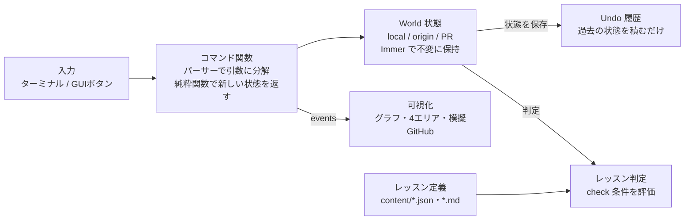

# Git Training 設計書

2026-11-01 · @Phycook

## 1. 概要・目的

Git Training は、Git と GitHub / GitLab の操作をブラウザ上で可視化しながら、初級から上級まで段階的に習得するための個人用ハンズオン学習サイトです。本設計書はそのまま Claude Code に渡して実装することを前提に書いています。本書では設計書の節を「§1〜§10」、カリキュラムの章を「第0〜8章」と呼び分けます。

**解決したい課題**

- コマンドを打っても「裏で何が起きたか」が見えず、理解が暗記止まりになる
- reset / rebase / revert など「歴史を書き換える」操作が怖くて実務で使えない
- PR やブランチ戦略はチーム開発でしか練習できず、個人では経験を積みにくい

**想定ユーザー**

- 利用者は自分1人（PHYCO）。Git の基本コマンドは触ったことがあるが、チーム開発の運用や履歴操作には自信がない段階

**ゴール（到達レベル）**

| レベル | できるようになること |
| --- | --- |
| 初級 | add / commit / push の意味を3つのエリアとグラフで説明できる |
| 中級 | ブランチ・マージ・コンフリクト解消・PR 作成からマージまでを1人で回せる |
| 上級 | revert / reset / rebase / reflog を使い分けて事故から復旧でき、チームのブランチ戦略を選定・説明できる |
| 発展 | Claude Code などの AI エージェントと Git（worktree・PR 自動化）を組み合わせて開発を回せる |

## 2. 前提と基本方針

完全無料・ブラウザ内完結・サーバーなしの静的サイトとして作り、GitHub Pages で公開します。

| 項目 | 方針 |
| --- | --- |
| コスト | 0円。有料 API・有料ホスティングは使わない |
| 実行環境 | ブラウザ内で Git をシミュレート（§6）。本物の GitHub への接続は不要 |
| ユーザー | 個人専用。ログインなし、進捗は localStorage / IndexedDB に保存 |
| フロント | React + TypeScript + Vite |
| スタイル | Tailwind CSS、アニメーションは Framer Motion、ホバー解説は Radix UI（Tooltip / HoverCard）、進捗グラフは Recharts |
| グラフ描画 | SVG を自前描画（レイアウト計算のみ自作 or d3-dag） |
| ターミナル | xterm.js 風の自作コンポーネント（入力補完・履歴付き） |
| 教材データ | 静的 JSON / Markdown（レッスン追加はファイル追加だけで済む） |
| テスト | Vitest（Git エンジンは単体テスト必須）、Playwright（E2E） |
| デプロイ | GitHub Actions → GitHub Pages。このリポジトリ自体を PR 運用し、学んだことを実践する題材にする |
| 対応端末 | PC 優先。スマホでも3ペインをタブ切替にしてレッスンを進められる（入力は GUI ボタン中心） |

**設計の原則**

1. 全操作を「実行前 → 実行後」の差分アニメーションで見せる（何が動いたかが一目で分かる）
2. GUI ボタンと CLI コマンドの両方で操作でき、ボタンを押すと対応するコマンドが表示される
3. 何度でも壊せる：Undo・リセット・スナップショットを常に用意する
4. 本物の Git と挙動を合わせる：シミュレータの簡略化は明示し、実 Git との差は解説に書く
5. 読ませるより見せる：解説文より動く図を優先し、画面上の用語・コミット・ブランチ・コマンドは全てホバー（スマホではタップ）で詳しい説明が出る

## 3. 学習カリキュラム

全9章（第0〜8章）・約36レッスン（1ヶ月で完走できる量に絞っています）。各章は「解説 → ハンズオン演習 → 理解度クイズ → 章末チャレンジ」の順で進み、章末チャレンジをクリアすると次章が解放されます。レッスン数の内訳は第0章 2・第1章 5・第2章 5・第3章 3・第4章 5・第5章 5・第6章 6・第7章 3・第8章 2 です。

| 章 | レベル | テーマ | 主なコマンド・概念 | 章末チャレンジ例 |
| --- | --- | --- | --- | --- |
| 0 | 入門 | Git とは何か | バージョン管理、分散型、Git と GitHub / GitLab の違い | 用語クイズ10問 |
| 1 | 初級 | 3つのエリアとコミット | init, status, add, commit, log, diff, restore, .gitignore | 指定どおりのコミット3つを作る |
| 2 | 初級 | ブランチとマージ | branch, switch, merge（fast-forward / 3-way）, HEAD | グラフをお手本と同じ形にする |
| 3 | 中級 | コンフリクト | 衝突マーカー、解消手順、merge --abort | コンフリクト3箇所を正しく解消 |
| 4 | 中級 | リモート | clone, remote, fetch, pull, push, 追跡ブランチ、push rejected | 他人の push を取り込んでから push |
| 5 | 中級 | PR / MR とチーム開発 | PR 作成、レビュー、マージ方式3種（merge / squash / rebase）、Issue 連携、ブランチ保護、CODEOWNERS、GitLab MR との差 | レビュー指摘を反映して PR をマージ |
| 6 | 上級 | 履歴の修正と復旧 | revert, reset（soft / mixed / hard）, commit --amend, stash, cherry-pick, rebase, rebase -i, reflog | 「誤って reset --hard した」状態から復旧 |
| 7 | 上級 | ブランチ戦略 | GitHub Flow, Git Flow, GitLab Flow, トランクベース、tag と SemVer、hotfix | リリース＋緊急 hotfix を戦略どおりに回す |
| 8 | 発展 | 内部構造と AI 時代の Git | blob / tree / commit オブジェクト、refs、bisect、worktree、hooks、Claude Code によるコミット・ PR 作成と並列開発 | bisect でバグ混入コミットを特定 |

**別枠：実戦シナリオモード**（第5章クリア後に解放）

- 仮想チームメンバー（Bot）が並行で push / PR を行い、その中で自分のタスクを完了させる
- 例：「リリース直前に main でバグ発覚」「秘密情報をコミットしてしまった」「長期ブランチが main から大きく乖離」
- フェーズ5で4本を追加（全7本）：「レビューで修正を頼まれた（fixup・autosquash・--force-with-lease）」「消してはいけないコミットを reset で消した（reflog）」「リリース済みの版にも修正を届ける（cherry-pick -x）」「いつの間にか CI が赤い（bisect run・revert の PR）」

**別枠：本物の環境での練習**（効果が高い章だけ実施）

基本はサイト内で完結します。ただし「認証」「本物の画面」「ローカル環境」はシミュレータでは身につかないため、次の3章だけ章末に実機演習を入れます（サイトは手順とチェックリストを表示するだけで、GitHub には接続しません）。

| 章 | 実機演習の内容 | 実機でやる理由 |
| --- | --- | --- |
| 4 | 自分の PC で GitHub に練習用リポジトリを作り、SSH 鍵設定 → clone → push | 認証エラーや設定は実環境でしか踏めない |
| 5 | 本物の GitHub で PR 作成 → セルフレビュー → squash マージ、ブランチ保護の設定 | 実際の画面と操作に慣れる |
| 8 | Claude Code で Git Training 自体の機能追加を worktree で並列に進め、PR を作らせる | AI との開発は本物のリポジトリでないと練習にならない |

また、このサイトの開発そのものを§9 の手順（ブランチ → PR → マージ）で進めることが、1ヶ月間を通した実機演習になります。

## 4. 機能要件

MVP は F-01〜F-08 と F-18・F-19（第0〜2章が遊べる状態）、それ以降はフェーズごとに追加します。

| ID | 機能 | 内容 | フェーズ |
| --- | --- | --- | --- |
| F-01 | Git シミュレーションエンジン | ワークツリー・インデックス・コミット・ブランチ・HEAD をメモリ上で管理し、コマンドで更新 | 1 |
| F-02 | ターミナル | git コマンド入力、Tab 補完、↑↓履歴、実 Git に近い出力メッセージ、エラー時の日本語ヒント | 1 |
| F-03 | エリア可視化 | ワークツリー / ステージ / ローカルリポジトリ / リモートの4列にファイルを表示し、add / commit / push で移動するアニメーション（リモート列はフェーズ2） | 1 |
| F-04 | コミットグラフ | コミットをノード、親子を線、ブランチ / HEAD / origin/* をラベルで表示。操作ごとに差分アニメーション | 1 |
| F-05 | 簡易エディタ | ファイルの作成・編集・削除（Monaco Editor）。コンフリクト時は衝突箇所をハイライト | 1 |
| F-06 | レッスンプレーヤー | 解説、ステップごとの課題、ヒント3段階、「答えを見る」、自動判定、次へ進む | 1 |
| F-07 | 進捗管理 | レッスン完了状況、章の解放、前回の続きから再開 | 1 |
| F-08 | Undo / スナップショット | 1操作戻す、レッスン初期状態に戻す、任意時点に保存 | 1 |
| F-09 | リモート・他開発者の模擬 | clone / remote / fetch / pull / push を実装。origin リポジトリをブラウザ内に持ち、「同僚が push した」イベントをシナリオから発生させる | 2 |
| F-10 | 模擬 GitHub 画面 | PR（MR）一覧・詳細・差分・レビューコメント・マージ方式選択・CI ステータス（模擬）・ブランチ保護。GitHub 風で統一（GitLab は用語の違いのみ解説） | 3 |
| F-11 | 履歴操作コマンド | revert, reset, amend, stash, cherry-pick, rebase, rebase -i, reflog, tag | 3 |
| F-12 | 比較ビュー | 同じ初期状態に対して merge / rebase / squash などを左右並べで実行し、結果の履歴を比較 | 3 |
| F-13 | ブランチ戦略シミュレータ | 戦略を選ぶとブランチ構成とルールが設定され、ルール違反（例：main へ直接 push）を警告 | 4 |
| F-14 | 実戦シナリオ | Bot メンバーが参加するシナリオ形式の総合演習、スコア表示 | 4 |
| F-15 | 内部構造ビュー | コミットをクリックすると commit → tree → blob のオブジェクトを展開表示、.git フォルダ風ビュー。第8章用に bisect・worktree・hooks（模擬）も実装 | 4 |
| F-16 | フリープレイ（サンドボックス） | 課題なしで自由に操作。状態を URL / JSON で書き出し・読み込み | 2 |
| F-17 | コマンド辞典 | 全コマンドの解説、危険度（履歴を失うか）、関連レッスンへのリンク | 2 |

**動的な可視化とホバー解説**

画面上に見えているものは全て「動く」か「触ると説明が出る」のどちらかにします。

| ID | 機能 | 内容 | フェーズ |
| --- | --- | --- | --- |
| F-18 | ホバー解説（グラフ） | コミット：ハッシュ・メッセージ・親・変更ファイル・どのブランチから辿れるか。ブランチ：指しているコミットと追跡先。HEAD：通常 / detached の意味 | 1 |
| F-19 | ホバー解説（用語・コマンド） | 解説文中の用語に点線下線、ホバーで用語カード。ターミナルで入力中のコマンドにも意味と危険度を表示 | 1 |
| F-20 | 実行プレビュー | Enter 前に「実行するとこうなる」をグラフ上に半透明で予告表示（merge / rebase / reset で特に有効） | 3 |
| F-21 | 動く図解 | 解説の中にステップ送り・自動再生できる図を埋め込む（例：3つのエリア、rebase のコミット付け替え） | 2 |
| F-22 | 操作の再生 | 操作履歴をスライダーで巻き戻し・早送りし、グラフの変化を再生 | 2 |
| F-23 | 学習ダッシュボード | ホームに章別の進捗バー、日別の学習量グラフ、ヒント使用率、ゴール日までの残り日数 | 2 |

- ホバーは 300ms 待ってから表示（マウスを動かしただけでチラつかないようにする）。スマホではタップで開閉
- 用語は `content/glossary.json` に集約し、解説 Markdown では `[[fast-forward]]` と書くだけでホバー解説が付く
- 動く図解は `:::figure{id="three-areas"}` のように Markdown から呼び出し、図の中身はエンジンの状態から描く（図とシミュレータの見た目を揃える）

## 5. 画面設計

中心は「レッスン画面」で、左に課題、中央に可視化、下にターミナルを置く3ペイン構成です。

| ID | 画面 | 主な要素 |
| --- | --- | --- |
| S-01 | ホーム | 続きから再開ボタン、章マップ（解放状況）、学習時間・クリア数 |
| S-02 | 章詳細 | 章のゴール、レッスン一覧、章末チャレンジ |
| S-03 | レッスン | 左：解説・課題・ヒント / 中央上：コミットグラフ / 中央下：4エリアビュー / 下：ターミナルと GUI 操作ボタン / 右上：Undo・リセット・「答え合わせ」 |
| S-04 | 模擬 GitHub | PR 一覧、PR 詳細（Conversation / Commits / Files changed）、マージボタン、リポジトリ設定（ブランチ保護）。S-03 内のタブとして開く |
| S-05 | 比較ビュー | 同じ初期グラフを2列に並べ、左右で違う操作を実行 |
| S-06 | 実戦シナリオ | S-03 の構成＋チャット風のチームタイムライン（Bot からの連絡・PR レビュー依頼） |
| S-07 | フリープレイ | S-03 から課題ペインを除いたもの。状態の書き出し / 読み込み |
| S-08 | コマンド辞典 | 検索、カテゴリ別一覧、危険度バッジ |

**レッスン画面（S-03）の操作体験**

1. 課題を読む（例：「README.md を修正してコミットしよう」）
2. ターミナルに入力、または GUI ボタンを押す
3. エリアビューとグラフがアニメーションで変化し、「今何が起きたか」を1行で表示
4. 課題の判定条件を満たすと自動でクリア、解説の続きを表示
5. 失敗しても Undo で戻れる。履歴を壊す操作では「実務ではここで事故になる」警告を表示

スマホ幅では3ペインをタブ切替（課題 / 可視化 / ターミナル）にします。

## 6. アーキテクチャと Git シミュレーション方式

Git は TypeScript で自作した「学習用 Git エンジン」でシミュレートします。可視化に必要な「操作ごとの差分」を取り出せ、rebase や revert まで全コマンドを扱えるのが選定理由です。



入力は必ずコマンド関数を通り、画面は状態を直接触らず events だけを受け取ります。

**方式の比較**

| 方式 | 対応コマンド | 可視化との相性 | 実装量 | 判断 |
| --- | --- | --- | --- | --- |
| 自作エンジン（TypeScript） | 必要なものを全て実装できる | 状態を直接持つので最良 | 多い（Claude Code で分割実装） | 採用 |
| isomorphic-git（ブラウザ内の実 Git 実装） | rebase や revert などが未対応 | 状態を毎回読み直す必要あり | 少ない | 不採用 |
| サーバーで本物の git を実行 | 全て | 出力のパースが必要 | 中 | サーバー費用がかかるため不採用 |

**エンジンの設計方針**

- 各コマンドは純粋関数 `(state, args) => { state, output, events }`。状態は不変（Immer）で、過去の状態をスタックに積むだけで Undo が実現できる
- `events`（例：`FILE_STAGED`, `COMMIT_CREATED`, `REF_MOVED`, `CONFLICT`）を可視化層が受け取り、アニメーションと「今何が起きたか」の説明文を生成する
- コミット ID は実 Git と同じオブジェクト形式の SHA-1（第8章の内部構造の学習でそのまま使える）。表示は先頭7桁
- マージはファイル単位の 3-way 判定＋行単位の diff3（node-diff3）。衝突時は実 Git と同じマーカーを書き込む
- リモート（origin）は別のリポジトリ状態として持ち、fetch / push でオブジェクトと ref をコピーする
- PR・レビュー・ブランチ保護は Git エンジンの外側の「ホスティング模擬層」に置き、画面は GitHub 風に統一し、GitLab（MR）との違いは第5章のコラムと用語対応表で扱う
- 対応しないオプションは「このサイトでは未対応。実 Git では…」と日本語で返す

**ディレクトリ構成（案）**

```
src/
  engine/        # Git エンジン（UI 非依存、単体テスト必須）
    commands/    # add.ts, commit.ts, merge.ts, rebase.ts ...
    model/       # Repo, Commit, Index, Ref の型
    merge/       # diff3, コンフリクト生成
    parser.ts    # コマンド文字列 → 引数
  hosting/       # PR / MR, レビュー, ブランチ保護, CI 模擬
  lesson/        # レッスン実行、判定、シナリオ Bot
  ui/            # React コンポーネント（Terminal, Graph, AreaView, HostingView）
  store/         # Zustand（進捗・設定）
content/
  lessons/       # ch01/01-first-commit.json + .md ...
  scenarios/
```

## 7. データ設計

レッスンは「初期状態＋ステップ（課題と判定条件）」の JSON と解説 Markdown の組で定義し、コードを変えずにレッスンを追加できるようにします。

**リポジトリ状態（エンジン内部）**

```ts
type RepoState = {
  objects: Record<Oid, Commit | Tree | Blob>;
  refs: { heads: Record<string, Oid>; tags: Record<string, Oid>; remotes: Record<string, Record<string, Oid>> };
  head: { type: 'symbolic'; ref: string } | { type: 'detached'; oid: Oid };
  index: Record<Path, Oid>;            // ステージングエリア
  workingTree: Record<Path, string>;   // ファイル内容
  reflog: ReflogEntry[];
  stash: StashEntry[];
  inProgress?: { op: 'merge' | 'rebase' | 'cherry-pick' | 'revert'; ... };
  config: { user: { name: string; email: string } };
};

type World = {                         // レッスン全体の状態
  local: RepoState;
  remotes: Record<string, RepoState>;  // origin など
  hosting: { pullRequests: PullRequest[]; protections: BranchProtection[] };
  clock: number;                       // 決定的な時刻（テストでハッシュを固定）
};
```

**レッスン定義（content/lessons/ch02/03-fast-forward.json）**

```json
{
  "id": "ch02-03",
  "title": "fast-forward マージ",
  "level": "beginner",
  "doc": "03-fast-forward.md",
  "setup": {
    "commits": [
      { "id": "c1", "msg": "init", "files": { "README.md": "# app" } },
      { "id": "c2", "parent": "c1", "msg": "add login", "files": { "login.ts": "..." } }
    ],
    "branches": { "main": "c1", "feature/login": "c2" },
    "head": "main"
  },
  "steps": [
    {
      "instruction": "feature/login を main にマージしてみよう",
      "hints": ["今いるブランチに取り込むコマンドは？", "git merge <ブランチ名>"],
      "answer": ["git merge feature/login"],
      "check": [
        { "type": "refEquals", "ref": "main", "to": "c2" },
        { "type": "noMergeCommit" }
      ],
      "explain": "main が c2 まで前に進んだだけで、新しいコミットは作られていません。"
    }
  ],
  "allowedCommands": ["status", "log", "merge", "switch", "branch"]
}
```

**判定条件（check）の種類**

| type | 意味 |
| --- | --- |
| refEquals | 指定 ref が特定コミットを指す |
| headOn | HEAD が指定ブランチ（または detached） |
| graphShape | コミットグラフがお手本と同型（ハッシュではなく形とメッセージで比較） |
| fileContent | ワークツリー / インデックス / コミット上のファイル内容 |
| statusClean | 未コミットの変更がない |
| commitCount | ブランチ上のコミット数 |
| noMergeCommit / hasMergeCommit | マージコミットの有無 |
| remoteEquals | origin 上の ref がローカルと一致 |
| prState | PR が merged / closed / approved など |
| commandUsed / commandNotUsed | 特定コマンドの使用有無（例：push --force 禁止） |

**進捗データ（IndexedDB）**

```ts
type Progress = {
  lessons: Record<LessonId, { status: 'todo' | 'doing' | 'done'; hintsUsed: number; clearedAt?: string }>;
  snapshots: Record<string, World>;   // フリープレイの保存
  studyLog: Record<string, number>;   // 日付 → 学習分数（ダッシュボード用）
  settings: { theme: 'light' | 'dark'; animationSpeed: number };
};
```

## 8. 非機能要件

| 区分 | 要件 |
| --- | --- |
| 性能 | コマンド実行から画面反映まで 100ms 以内（アニメーション時間を除く）。コミット200個までグラフが滑らかに描画できる |
| 正確性 | 主要コマンドは実 Git と同じ結果になることを、実 Git で作った期待値との比較テスト（ゴールデンテスト）で担保。期待値は CI 上で本物の git を実行するスクリプトで JSON に書き出す |
| テスト | engine/ のカバレッジ 80% 以上。全レッスンの模範解答を自動実行してクリアできることを CI で確認 |
| 保存 | 進捗は自動保存。JSON でエクスポート / インポートでき、ブラウザを変えても引き継げる |
| オフライン | 一度開けば通信なしで動く（フェーズ5で PWA 化）。service worker がビルドした全ファイルを最初に保存し、新しい版は画面下のお知らせの「更新」で切り替える |
| アクセシビリティ | 色だけに依存しない（ブランチは色＋ラベル）。アニメーション速度を調整・停止できる |
| セキュリティ | 外部通信なし。入力は全てエンジン内で処理し、eval 等は使わない |
| 言語 | UI・解説は日本語。コマンド出力は実 Git と同じ英語＋日本語の補足 |
| 保守性 | コマンド1つ＝1ファイル＋テスト1ファイル。新コマンド追加は登録表に1行足すだけ |

## 9. Claude Code での実装計画

開発と学習を1ヶ月（4週）で終えるため、1週＝1フェーズとし、週の前半で Claude Code に作らせ、後半でその章を学習します。各フェーズは「ブランチ → PR → レビュー → マージ」で進めます。作る過程そのものが Git / GitHub の実践になります。

| 週 | 開発（前半） | 学習（後半） | 週末の完了条件 |
| --- | --- | --- | --- |
| 1週目 | フェーズ1：F-01〜F-08, F-18, F-19 | 第0〜2章 | add / commit / branch / merge が可視化＋ホバー解説付きで動き、GitHub Pages に公開済み |
| 2週目 | フェーズ2：F-09, F-16, F-17, F-21〜F-23 | 第3・4章＋実機演習（SSH・push） | コンフリクト解消と fetch / pull / push ができる |
| 3週目 | フェーズ3：F-10〜F-12, F-20 | 第5・6章＋実機演習（本物の PR） | 模擬 GitHub で PR をマージでき、reset / rebase / reflog で復旧できる |
| 4週目 | フェーズ4：F-13〜F-15 | 第7・8章＋実戦シナリオ3本＋実機演習（Claude Code と worktree） | 全章クリア |

- 1日あたり約1.5〜2時間を想定。遅れた場合は F-20（実行プレビュー）と F-15（内部構造ビュー）を後回しにする
- 1ヶ月に収めるため、PWA 対応は対象外。実戦シナリオは3本まで
- 追加フェーズ（フェーズ5）：1ヶ月の計画の後に、実戦シナリオ4本の追加、ゴールデンテストの拡充、PWA 対応を行った

**Claude Code への渡し方**

1. 本設計書を Markdown で書き出し、リポジトリの `docs/design.md` に置く
2. `CLAUDE.md` に定常ルールを書く：「engine/ は UI に依存させない」「コマンド追加時はテストを先に書く」「1フェーズ＝1ブランチ、小さなコミットに分ける」「main へ直接 push しない」
3. 各フェーズは `/sear-and-build 設計書 §9 のフェーズX` で開始する（`.claude/skills/sear-and-build/`）。Claude Code はユーザーにしか決められない判断だけを質問し、残りは決定事項の一覧にして即実装し、最後に「決定事項 → 実装場所」の対応表を返す。push・PR 作成・公開など外部に出る操作は都度確認する
4. Claude Code に PR を作らせ、自分で差分をレビューしてからマージする（第5章の実習を兼ねる）
5. フェーズ3以降は git worktree で「エンジン」と「レッスン作成」を並列に進める（第8章の実習を兼ねる）

**教材コンテンツの作り方**

- レッスン JSON と解説 Markdown は Claude Code に生成させ、「模範解答の自動実行テスト」に通ることを合格条件にする
- 解説の正確性は Git 公式ドキュメント（git-scm.com）、GitHub Docs、GitLab Docs を参照させる

## 10. 決定事項

| 項目 | 決定 | 反映先 |
| --- | --- | --- |
| サイト名 | Git Training | 全体 |
| 模擬画面 | GitHub 風に統一。GitLab は用語の違いのみ解説 | §4・§6 |
| 期間 | 1ヶ月（4週）で開発と学習を完了 | §3・§9 |
| 実機演習 | サイト内完結が基本。第4・5・8章のみ実機演習を追加 | §3 |
| フレームワーク | React | §2 |
| 見せ方 | 動的な可視化＋ホバー解説を全画面で採用 | §2・§4 |

残る未決事項はありません。次は本書を Markdown で書き出し、フェーズ1を Claude Code に依頼します。
